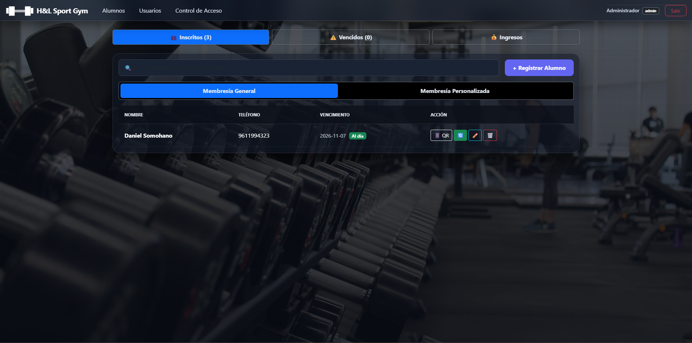
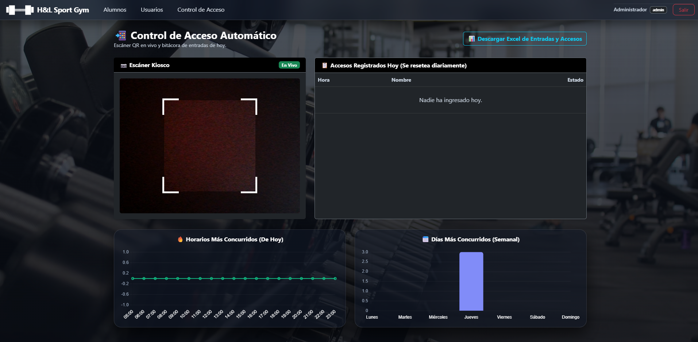
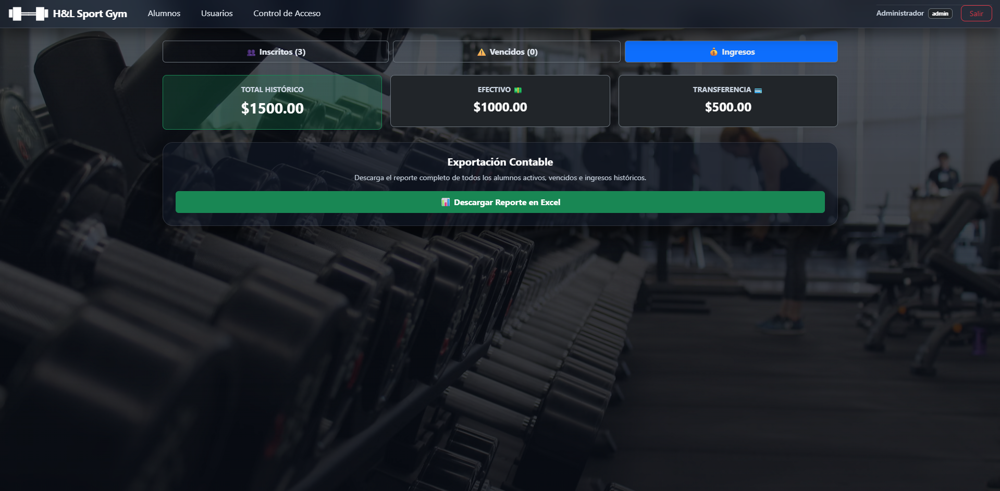
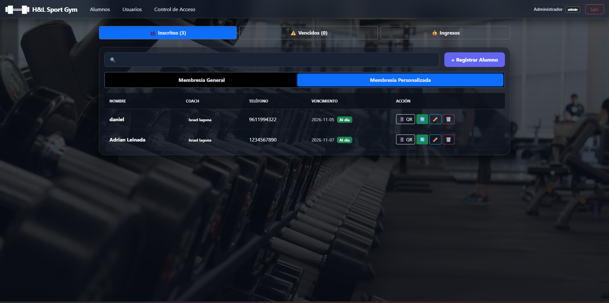
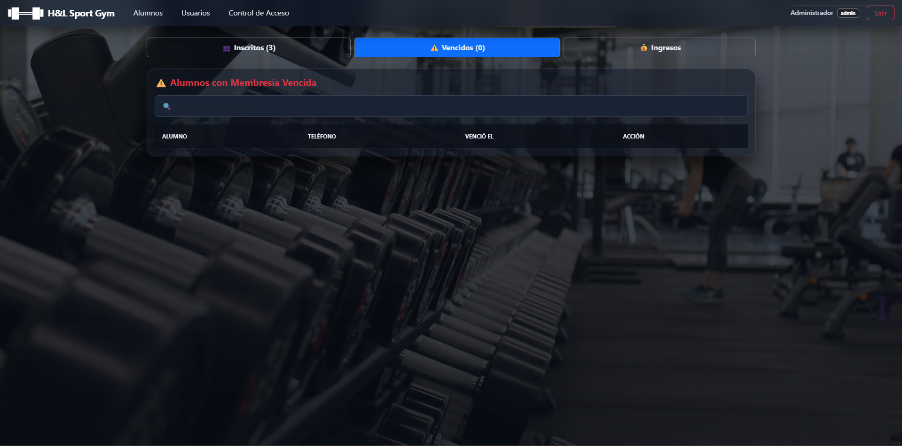
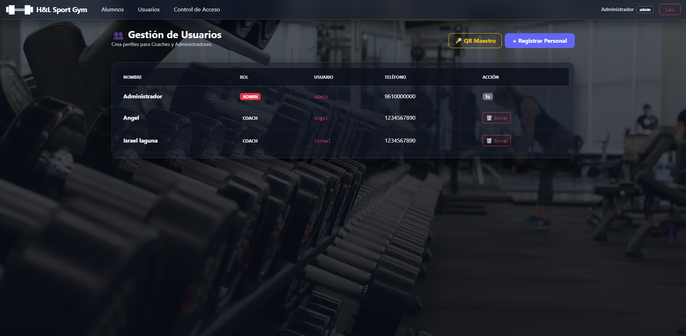
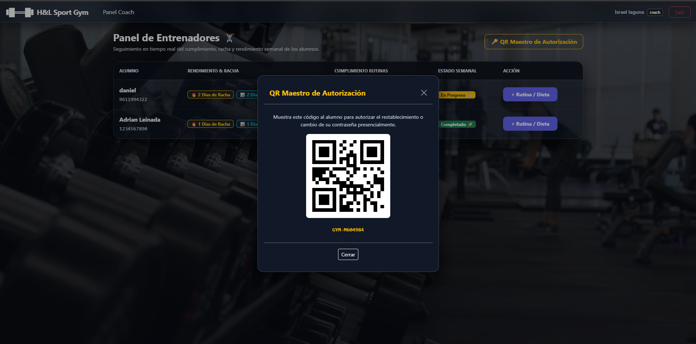
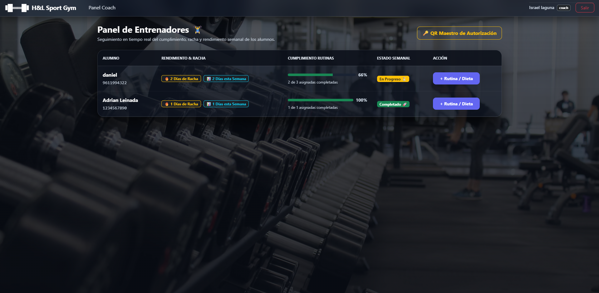
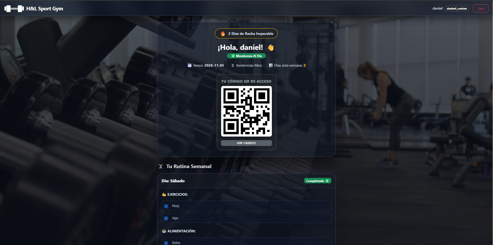
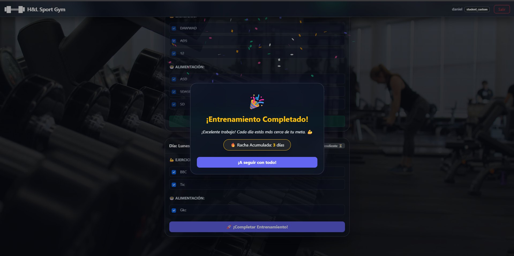

## 🚀 GymWeb SaaS

**GymWeb** es una plataforma modular para la administración integral de gimnasios y centros de acondicionamiento físico, diseñada con una arquitectura backend robusta para automatizar el control de accesos por códigos QR en tiempo real, gestión financiera, membresías y seguimiento de entrenamientos personalizados.

---

## 📸 Módulos y Funcionalidades del Sistema

### 1. Panel de Administración General
Vista centralizada para administrar alumnos inscritos, filtrar membresías generales o personalizadas, dar de alta nuevos usuarios y supervisar pagos[cite: 10, 14].

<p align="center">
  
</p>

---

### 2. Control de Acceso Automático por Código QR (Kiosco)
Módulo en tiempo real con escáner de códigos QR y bitácora de entradas, incluyendo gráficas dinámicas de afluencia por hora y días de la semana[cite: 15].

<p align="center">
  
</p>

---

### 3. Gestión de Ingresos y Reportes Contables
Panel financiero que calcula ingresos históricos totales, divididos por método de pago (Efectivo vs. Transferencia) con exportación de reportes a Excel[cite: 13].

<p align="center">
  
</p>

---

### 4. Gestión de Alumnos y Filtrado por Membresía
Alternancia fluida entre membresías generales y personalizadas, mostrando el coach asignado, datos de contacto, vencimientos y acciones rápidas de edición o control[cite: 10, 14].

<p align="center">
  
</p>

---

### 5. Alumnos con Membresía Vencida
Sistema automatizado de alertas para identificar socios con pagos atrasados[cite: 19].

<p align="center">
  
</p>

---

### 6. Panel de Gestión de Usuarios (Personal)
Control de roles (`ADMIN` y `COACH`) con opciones de seguridad y códigos QR maestros de autorización presencial[cite: 16, 18].

<p align="center">
  
</p>

<p align="center">
  
</p>

---

### 7. Panel de Entrenadores (Coaches)
Supervisión de rendimiento semanal, cumplimiento de rutinas y asignación de planes de entrenamiento o dietas[cite: 12].

<p align="center">
  
</p>

---

### 8. Portal del Alumno (Gamificación y Rachas)
Panel del socio para consultar estado de membresía, código QR personal, rutina semanal y sistema de rachas con notificaciones al completar entrenamientos[cite: 11, 17].

<p align="center">
  
</p>

<p align="center">
  
</p>

---

## ⚙️ Instalación y Configuración Local

```bash
# 1. Clona el repositorio
git clone [https://github.com/Somohanito/Gym-Web.git](https://github.com/Somohanito/Gym-Web.git)
cd Gym-Web

# 2. Crea y activa un entorno virtual
python -m venv venv
# En Windows:
venv\Scripts\activate
# En macOS/Linux:
source venv/bin/activate

# 3. Instala las dependencias
pip install -r requirements.txt

# 4. Ejecuta la aplicación
python app.py

```

## 👨‍💻 Autor

Axel Daniel Somohano
Biomedical Engineer & Backend Developer
GitHub: @Somohanito (https://github.com/Somohanito)

```

```
